<!--
  The images in assets/ and the sections between the "live:" markers are
  regenerated every hour by .github/workflows/profile.yml from live GitHub data.
  Everything else in this file is hand-written: edit it freely.
-->

<a href="https://nikhilreddy00.github.io/nikhilreddy00/#terminal">
<picture>
  <source media="(prefers-color-scheme: dark)" srcset="assets/agent-trace-dark.svg">
  
</picture>
</a>

<b>▶ This page is a snapshot. The live version is interactive:</b> <a href="https://nikhilreddy00.github.io/nikhilreddy00/#terminal">type in the terminal</a> · <a href="https://nikhilreddy00.github.io/nikhilreddy00/#map">drag the latent space</a> · <a href="https://nikhilreddy00.github.io/nikhilreddy00/#dashboard">filter the dashboard</a>

### Talk to my agent

Run a command on my profile agent without leaving GitHub. Click one, then **Create**. A GitHub Action answers in your issue in about 30 seconds, and your run shows up in the log below.

  
  
  
  
  
  
  
  
  

<!--live:agent:start-->
**3 commands** run by **1 visitor** so far. Latest:

| Visitor | Ran | When |
| :-- | :-- | :-- |
| [@nikhilreddy00](https://github.com/nikhilreddy00) | `help` | 2026-10-16 01:15 EDT |
| [@nikhilreddy00](https://github.com/nikhilreddy00) | `stats 90` | 2026-10-16 00:36 EDT |
| [@nikhilreddy00](https://github.com/nikhilreddy00) | `whoami` | 2026-10-16 00:34 EDT |
<!--live:agent:end-->

Commands only, a few per visitor per day. Want to type freely? Use the <a href="https://nikhilreddy00.github.io/nikhilreddy00/#terminal">interactive terminal</a>.

## Nikhil Reddy · AI Engineer

I build production LLM systems: retrieval, multi-agent pipelines, and agents that operate real software. I've spent 3+ years doing it across healthcare and financial services, and I'm now a **Data Scientist at Echelon Insights**.

I put deterministic guardrails outside the model wherever correctness matters, and I ship with eval harnesses, drift monitoring and release ownership.

  
  
  

### Featured builds

<table>
  <tr>
    <td width="50%" valign="top">
      <a href="https://github.com/nikhilreddy00/praxis"><b>Praxis</b></a> · record once, replay many  
      An LLM drives legacy back-office software through Playwright once. After that, the recorded workflow replays deterministically with no model in the loop, and a test enforces that guarantee. It has policy guardrails, a human takeover path, and an MCP server that exposes only approved capabilities. 624 tests passing.  
      <code>TypeScript</code> <code>Playwright</code> <code>MCP</code>
    </td>
    <td width="50%" valign="top">
      <a href="https://github.com/nikhilreddy00/AnalystAI"><b>AnalystAI</b></a> · multi-agent data analyst  
      Upload a raw CSV and a 7-agent LangGraph pipeline writes Python, runs it in an E2B sandbox, and returns charts with written insight. Chart selection and quality gates stay deterministic Python rather than model calls.  
      <code>LangGraph</code> <code>FastAPI</code> <code>Next.js</code> <code>Qdrant</code> <code>Postgres</code>
    </td>
  </tr>
</table>

### Latent space of my work

<a href="https://nikhilreddy00.github.io/nikhilreddy00/#map">
<picture>
  <source media="(prefers-color-scheme: dark)" srcset="assets/latent-space-dark.svg">
  
</picture>
</a>

Every public repo is embedded from its README, description and topics (TF-IDF → LSA), clustered with k-means, and projected to 2-D. A new repo appears on the map within the hour. <a href="https://nikhilreddy00.github.io/nikhilreddy00/#map"><b>Drag the bubbles yourself →</b></a>

<b>How the map is computed</b> · what each cluster contains and the terms that define it

 

Each repo becomes a TF-IDF vector over its README, description and topics, which LSA compresses to 10 dimensions. k-means groups the vectors, trying k = 3 to 7 and keeping the k with the best silhouette score. Each cluster is named from its strongest terms, and the map places similar clusters near each other.

<!--live:clusters:start-->
| Cluster | Repos | Strongest terms |
| :-- | :-- | :-- |
| **Classical ML** | [Customer-Churn-Prediction](https://github.com/nikhilreddy00/Customer-Churn-Prediction), [HealthInsurance-PremiumPrediction](https://github.com/nikhilreddy00/HealthInsurance-PremiumPrediction), [LinearRegression](https://github.com/nikhilreddy00/LinearRegression) | `customer` · `linear` · `regression` · `eda` · `customers` · `random` |
| **Data analytics** | [MNIST-NeuralNetwork](https://github.com/nikhilreddy00/MNIST-NeuralNetwork), [Loan-Performance-Data-Insights](https://github.com/nikhilreddy00/Loan-Performance-Data-Insights), [SEC-Corporate-Filings-Insights](https://github.com/nikhilreddy00/SEC-Corporate-Filings-Insights), [Urban-Transit-Optimization-and-Fare-Prediction---NYC-Taxi-Analytics](https://github.com/nikhilreddy00/Urban-Transit-Optimization-and-Fare-Prediction---NYC-Taxi-Analytics), [NYSO-Electricity-Consumption-and-Pricing-Insights](https://github.com/nikhilreddy00/NYSO-Electricity-Consumption-and-Pricing-Insights) | `learning` · `insights` · `big` · `machine` · `loan` · `models` |
| **Agentic RAG** | [sec-finance-rag](https://github.com/nikhilreddy00/sec-finance-rag), [vectorless-rag](https://github.com/nikhilreddy00/vectorless-rag), [Metadata-Aware-Rag](https://github.com/nikhilreddy00/Metadata-Aware-Rag), [rag-multipdf-qa](https://github.com/nikhilreddy00/rag-multipdf-qa), [rag-pdf-qa](https://github.com/nikhilreddy00/rag-pdf-qa) | `rag` · `chunks` · `sec` · `langchain` · `vector` · `retrieval` |
| **Health AI** | [MedSignal-API](https://github.com/nikhilreddy00/MedSignal-API), [pharma-agent](https://github.com/nikhilreddy00/pharma-agent) | `drug` · `pubmed` · `safety` · `fda` · `pharmacovigilance` · `assessment` |
| **Voice agents** | [clinic-voice-agent](https://github.com/nikhilreddy00/clinic-voice-agent), [outbound-clinic-voice-agent](https://github.com/nikhilreddy00/outbound-clinic-voice-agent) | `voice` · `call` · `cartesia` · `deepgram` · `real` · `clinic` |
| **Computer use** | [praxis](https://github.com/nikhilreddy00/praxis), [AnalystAI](https://github.com/nikhilreddy00/AnalystAI), [travel-wiki](https://github.com/nikhilreddy00/travel-wiki), [resumegenerator](https://github.com/nikhilreddy00/resumegenerator) | `claude` · `wiki` · `anthropic` · `api` · `travel` · `pages` |
| **Multi-agent systems** | [student-mental-health-ews](https://github.com/nikhilreddy00/student-mental-health-ews), [mirofish-meta-layoffs](https://github.com/nikhilreddy00/mirofish-meta-layoffs) | `ai-powered` · `mirofish` · `multi-agent` · `simulation` · `shap` · `hours` |
<!--live:clusters:end-->

### Recently shipped

<!--live:recent:start-->
| Project | What it does | Language | Last push |
| :-- | :-- | :-- | :-- |
| [**clinic-voice-agent**](https://github.com/nikhilreddy00/clinic-voice-agent) ★2 | 📞 An always-on AI voice agent that answers a real phone and books clinic appointments end-to-end… | Python | Sep 07, 2026 |
| [**student-mental-health-ews**](https://github.com/nikhilreddy00/student-mental-health-ews) | 🎓 AI-powered early warning system detecting struggling university students weeks before crisis… | Jupyter Notebook | Aug 22, 2026 |
| [**outbound-clinic-voice-agent**](https://github.com/nikhilreddy00/outbound-clinic-voice-agent) | AI voice agent that calls patients after hospital discharge, screens for warning signs, and… | Python | Aug 02, 2026 |
| [**mirofish-meta-layoffs**](https://github.com/nikhilreddy00/mirofish-meta-layoffs) | AI-powered multi-agent simulation of Meta's April 2026 layoffs — 26 stakeholder agents, 720… | Python | May 01, 2026 |
| [**sec-finance-rag**](https://github.com/nikhilreddy00/sec-finance-rag) | Production RAG chatbot over 25,000+ SEC EDGAR filings (S&amp;P 500) — Claude · BGE · Hybrid BM25+Dense… | HTML | Apr 28, 2026 |
<!--live:recent:end-->

### Training run

<a href="https://nikhilreddy00.github.io/nikhilreddy00/#dashboard">
<picture>
  <source media="(prefers-color-scheme: dark)" srcset="assets/training-run-dark.svg">
  
</picture>
</a>

<a href="https://nikhilreddy00.github.io/nikhilreddy00/#dashboard"><b>Open the interactive dashboard →</b></a> hover for exact values, drag across the chart to filter every tile, click a language to filter projects.

<b>Drill down: last 12 months</b> · contribution heatmap and weekday profile

 

<picture>
  <source media="(prefers-color-scheme: dark)" srcset="assets/training-history-dark.svg">
  
</picture>

<b>Drill down: commits by repository</b> · where the last 12 months of work went

 

<!--live:repos:start-->
| Repository | Commits · 12 mo | Share |
| :-- | --: | :-- |
| [rag-pdf-qa](https://github.com/nikhilreddy00/rag-pdf-qa) | 5 | `████████████████` 21% |
| [student-mental-health-ews](https://github.com/nikhilreddy00/student-mental-health-ews) | 3 | `██████████░░░░░░` 12% |
| [rag-multipdf-qa](https://github.com/nikhilreddy00/rag-multipdf-qa) | 3 | `██████████░░░░░░` 12% |
| [praxis](https://github.com/nikhilreddy00/praxis) | 3 | `██████████░░░░░░` 12% |
| [clinic-voice-agent](https://github.com/nikhilreddy00/clinic-voice-agent) | 2 | `██████░░░░░░░░░░` 8% |
| [MNIST-NeuralNetwork](https://github.com/nikhilreddy00/MNIST-NeuralNetwork) | 2 | `██████░░░░░░░░░░` 8% |
| [outbound-clinic-voice-agent](https://github.com/nikhilreddy00/outbound-clinic-voice-agent) | 1 | `███░░░░░░░░░░░░░` 4% |
| [mirofish-meta-layoffs](https://github.com/nikhilreddy00/mirofish-meta-layoffs) | 1 | `███░░░░░░░░░░░░░` 4% |
| [travel-wiki](https://github.com/nikhilreddy00/travel-wiki) | 1 | `███░░░░░░░░░░░░░` 4% |
| [vectorless-rag](https://github.com/nikhilreddy00/vectorless-rag) | 1 | `███░░░░░░░░░░░░░` 4% |
| [MedSignal-API](https://github.com/nikhilreddy00/MedSignal-API) | 1 | `███░░░░░░░░░░░░░` 4% |
| [pharma-agent](https://github.com/nikhilreddy00/pharma-agent) | 1 | `███░░░░░░░░░░░░░` 4% |

Plus 12 private contributions that GitHub counts but doesn't attribute to a repository.
<!--live:repos:end-->

### Career

<picture>
  <source media="(prefers-color-scheme: dark)" srcset="assets/career-dark.svg">
  
</picture>

### How I build

<picture>
  <source media="(prefers-color-scheme: dark)" srcset="assets/stack-dark.svg">
  
</picture>

<b>Plain-text version</b> · experience, stack and education as text

 

| When | Role | Highlights |
| :-- | :-- | :-- |
| Sep 2026 – now | **Data Scientist** · Echelon Insights | |
| Jan 2025 – Aug 2026 | **AI Engineer** · Milken Institute School of Public Health, GWU | Hybrid BM25 + embedding retrieval with cross-encoder reranking over 15K behavioral-health records (RAGAS answer relevancy 0.61 → 0.82). Fine-tuned BERT classifier (macro-F1 0.68 → 0.84). SageMaker endpoint p95 2.8 s → 1.4 s, run in production for 11 months. |
| Aug – Dec 2024 | **Data Science Consultant** · Data Science for Sustainable Development | FAISS semantic search across JSON, CSV and Parquet that surfaced ~1,200 mismatched records. PySpark feature pipelines on Databricks cut study prep from two days to four hours. |
| May 2023 – May 2024 | **Data Scientist, Conversational AI** · Cogno AI (acquired by Exotel) | Intent classification across 40+ banking intents (macro-F1 0.71 → 0.86). Agent-assist retrieval over 10K documents (top-3 relevance 62% → 84%). FastAPI serving at 380 ms p95. |

**Stack:** LangGraph · CrewAI · MCP · RAG (hybrid BM25 + dense, reranking) · Qdrant · FAISS · ChromaDB · Pinecone · Claude · GPT · Llama · BERT · LoRA / QLoRA · PyTorch · Hugging Face · XGBoost · RAGAS · DeepEval · LangSmith · FastAPI · Docker · AWS (SageMaker, Bedrock, Lambda, S3) · MLflow · GitHub Actions · Python · TypeScript · SQL · PySpark · Databricks · Snowflake · Postgres

**Education:** MS Data Analytics, The George Washington University (2026) · B.Tech Computer Science, Dayananda Sagar University (2024)

---

The visuals on this page are rebuilt every hour by a GitHub Action from live GitHub data. Private repositories count toward totals only and are never named. Last update: <!--live:updated:start-->2026-10-16 12:39 EDT<!--live:updated:end-->
